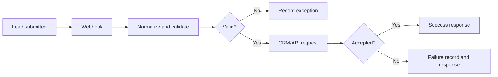

# One Prospect, One Record: Reliable Lead Intake with n8n

**Lead validation · Webhooks · JavaScript · CRM APIs · Exception handling**

## The challenge

A prospect fills out your form three times. Your CRM creates three records. Your team may contact the same person repeatedly, while your report counts three opportunities.

Then an API fails halfway through a different submission. Was that lead saved? Can you retry without creating another copy?

Those are the operational problems this workflow is meant to help solve.

## What I built

An **11-node n8n intake workflow** that receives an event, cleans incoming fields, checks basic validity, sends eligible submissions to an external endpoint, and records exceptions when something goes wrong.

| Stage | What the workflow does | Why it matters |
| --- | --- | --- |
| **Receive** | Accepts a lead event through a webhook | Gives forms and other sources a consistent entry point |
| **Clean** | Normalizes names and emails using JavaScript | Reduces inconsistent records |
| **Validate** | Checks the event ID and required email format | Flags unusable submissions early |
| **Route** | Sends eligible requests to a CRM/API endpoint | Moves data to the next system |
| **Handle failures** | Records exceptions and returns a response | Makes troubleshooting and retry decisions easier |

The workflow includes an event ID that can support duplicate prevention. **Persistent deduplication still depends on correctly enforcing that ID in the receiving system** and must be demonstrated in integration tests.

## How it works

## Explore the code

- **[11-node workflow export](workflows/01-w1-reliable-lead-intake-deduplication.json)**
- **[Node-by-node map](docs/WORKFLOW_MAP.md)**
- **[Setup and test checklist](docs/REPLICATION_CHECKLIST.md)**
- **[Audit findings](docs/REVIEW_AND_TEST_RESULTS.md)**
- **[Workflow validation script](scripts/validate_workflows.py)**

## Try it with synthetic leads

1. Import the workflow into a test n8n instance and keep it inactive until configured.
2. Replace the example API endpoint, reconnect test credentials, and create the required n8n Data Tables.
3. Submit one valid fictional event. Confirm normalization and the expected CRM call.
4. Submit the **same event ID twice**. Verify whether the downstream CRM actually creates only one record.
5. Submit an invalid email and a record missing key details. Inspect the exception and response paths.
6. Simulate an API timeout or failure. Check the error record and safe retry behavior.

The current validator can accept a lead **without a name** if it has an event ID and valid email. Decide whether that matches your business rules before deploying.

## What this project demonstrates

Webhook design, JavaScript data cleaning, conditional routing, API integration, and error handling. It also shows the kind of thinking needed to make a lead-management process observable and easier to recover when services fail.

Selected validation logic has passed synthetic tests. **Reliable deduplication, CRM writes, retries, and end-to-end delivery are not yet verified.** No improvement metric is claimed.

**Security note:** Use fictional leads for demos. Keep webhook URLs, credentials, and real prospect information outside the public repository.
