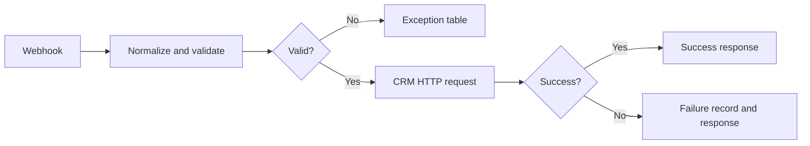

# Reliable Lead Intake & Deduplication | n8n

## Why it exists

When prospects submit the same form twice or leave required fields blank, the CRM can fill with duplicate or broken records. A second problem appears when an API fails midway: the lead has been accepted by the form but not safely delivered downstream.

This n8n workflow explores an explicit intake contract that validates and normalizes records, checks or records exceptions, calls the next system, and responds with an intelligible status.

## Workflow

## Reproduce

1. Import the sanitized n8n export from `workflows/`.
2. Configure the instance-specific n8n Data Tables and replace placeholder external endpoints.
3. Send a synthetic valid lead, an invalid lead and a repeated lead to the webhook.
4. Compare CRM calls, exception records, response codes and duplicate outcomes.
5. Add tests for remote API timeouts and retry behavior before production deployment.

## What is demonstrated

Webhook orchestration, JavaScript normalization, conditional routing, exception handling, HTTP integrations and structured webhook responses.

**Limitations:** This is a template snapshot. A full end-to-end test against your own CRM, reliable retries and idempotency verification remain necessary. Do not assume a duplicate is eliminated without observing persistent state.
